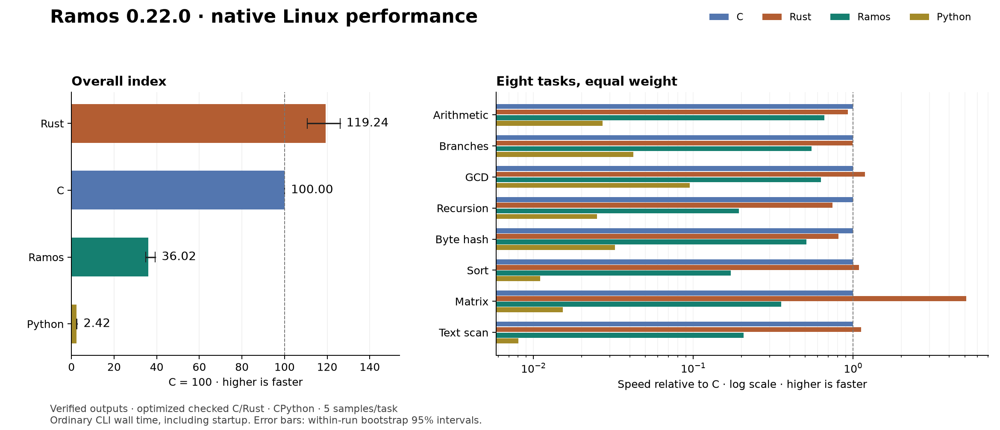

# Ramos 0.22.0 performance: eight-task index

Measured 2026-10-12T17:48:33.683094+00:00 on x86-64 Linux. Higher scores are faster; optimized C = 100.

| Language | Overall execution index | Within-run bootstrap 95% interval |
|---|---:|---:|
| Rust | 119.24 | 110.66–126.02 |
| C | 100.00 | 100.00–100.00 |
| Ramos | 36.02 | 34.76–39.32 |
| Python | 2.42 | 2.37–2.64 |

Across these tasks, Ramos is **14.87× faster than Python**, and takes **2.78× the time of C** and **3.31× the time of Rust** (geometric means of per-task median ratios).

## Per-task execution time

Median wall time in milliseconds for the same work and seed. Includes process creation, loading, argument parsing, allocation, computation and one checked output line.

| Task | Work count | Ramos | C | Rust | Python | Ramos vs Python |
|---|---:|---:|---:|---:|---:|---:|
| Serial integer arithmetic / modulo | 5,862,882 | 41.501 | 27.338 | 29.457 | 1009.986 | 24.34× |
| Data-dependent branches | 2,287,934 | 46.265 | 25.485 | 25.629 | 603.905 | 13.05× |
| Euclidean GCD | 460,468 | 51.264 | 32.239 | 27.158 | 339.584 | 6.62× |
| Runtime-seeded recursive tree | 1,050 | 138.463 | 26.742 | 35.993 | 1068.172 | 7.71× |
| Rolling byte-buffer hash | 5,458,812 | 48.707 | 24.861 | 30.771 | 768.952 | 15.79× |
| Insertion sort of 128 bytes | 8,168 | 174.105 | 29.872 | 27.533 | 2712.838 | 15.58× |
| 16×16 byte matrix multiplication | 18,472 | 384.342 | 136.403 | 26.784 | 8952.307 | 23.29× |
| Scan 16 KiB ASCII text | 1,619 | 145.742 | 30.147 | 26.812 | 3742.955 | 25.68× |

## Score definition

`Index(language) = 100 × geometric_mean(C_median(task) / language_median(task))`

All eight tasks have equal weight. The suite measures execution of ordinary programs, not patched code, an in-process kernel, compilation throughput or a universal language score. Startup is included in task timings but its separate probe is excluded from the index. The 95% intervals resample the collected timing samples; they do not capture uncertainty from different machines, task selection or operating systems.

## Tasks and correctness

- LCG: serial multiply/add/modulo recurrence with runtime seed.
- Branches: runtime-generated parity and divisibility branches with checksum.
- GCD: Euclidean remainder loops on varying positive inputs.
- Recursion: traverse a depth-12 binary tree with runtime-dependent child values and leaf checksum.
- Byte hash: visit a 4 KiB buffer and update a bounded polynomial hash.
- Insertion sort: refill and sort 128 bytes; checksum weights sorted positions.
- Matrix: multiply two 16×16 byte matrices, writing one input cell per pass, reduce output cells modulo 256, then checksum weighted positions.
- Text scan: classify digits, uppercase ASCII and spaces in 16 KiB; write one byte per pass.

Programs use the same algorithms, sizes, deterministic data and work count in all four languages. Work counts and seeds come from command-line arguments, so answers are not compile-time constants. All 32 task implementations pass independent reference checks at counts 0, 1 and 7 with seeds 1, 17 and 123. Full-size outputs are checked against references on every warmup and timed execution. Native compilers can optimize code normally; recursive calls may be transformed or inlined.

## Measurement method

- 5 timed samples per task/language; randomized language order within each round, sequential execution, two verified warmups.
- Work counts calibrated until both C and Rust took at least about 25 ms in the calibration probes. The same count is then held fixed for all languages.
- Work counts were calibrated for this run.
- Pinned to logical CPU 0; Python `perf_counter_ns` wall clock.
- Shared virtual machine; CPU frequency, other tenants and background activity are not controlled. Warm filesystem caches; no Windows performance claim.
- CPython executes source scripts normally, including parsing on every launch. C/Rust/Ramos binaries are built before execution timing.
- GCC: `-O3 -std=c11`, with checked add/subtract/multiply builtins and explicit byte bounds.
- Rust: `-C opt-level=3 -C overflow-checks=yes -C panic=abort`; safe byte indexing/conversion.
- Ramos: default native backend (release instruction selection described in the repository); arithmetic, buffer and call-depth checks retained. Python integers stay within signed 64-bit range for these inputs. C/Rust can eliminate provably redundant checks; Python has no Ramos-style call-depth or byte arena limit. Limits are not reached by the suite.

Raw nanosecond samples, p10/p90, calibration probes, build commands, source hashes and compiler/environment versions are retained in [results.json](results.json).

## Startup probe (excluded from index)

Argument parsing and printing a supplied integer; median over 51 randomized launches.

| Ramos | C | Rust | Python |
|---:|---:|---:|---:|
| 0.427 ms | 0.805 ms | 1.325 ms | 17.780 ms |

## Builds and output size (excluded from index)

Median of three builds per task, including compiler startup and linking/publication. The table shows geometric means across tasks. It is not a general compiler throughput ranking: source sizes differ, and C/Rust use broader optimizers than the local Ramos emitter. Python is run as source and has no native binary in this experiment. Sizes are unstripped compiler outputs with different standard-library/linkage choices.

| Language | Build time | Native binary size | Source size |
|---|---:|---:|---:|
| Ramos | 8.252 ms | 20480 B | 750 B |
| C | 64.241 ms | 16616 B | 1547 B |
| Rust | 168.758 ms | 4506097 B | 925 B |
| Python | — | — | 475 B |

## Next work for Ramos

1. Profile the largest native gaps before adding an optimization pass: Insertion sort of 128 bytes (5.8× C time), Runtime-seeded recursive tree (5.2× C time), Scan 16 KiB ASCII text (4.8× C time). Changes need their own measurements.
2. Compare each optimizer change against these exact work counts and compiler hashes, with fresh samples, language correctness tests and both self-hosting proofs. See the archived [0.7.0/0.7.1 comparison](https://github.com/zackmsa777-a11y/ramos-benchmarks/blob/main/benchmarks/optimization.md).
3. Measure native Windows separately, then extend the suite with real file-processing programs. Keep syntax small while improving generated code.

Optional chart: generate `score.png` with `benchmarks/plot_results.py --results RESULTS --output IMAGE`.

## Environment

- CPU: Intel(R) Xeon(R) Platinum 8358 CPU @ 2.60GHz
- Platform: Linux-6.17.0-1020-oracle-x86_64-with-glibc2.39
- Ramos 0.22.0 — compiler written in Ramos; Linux and Windows x64
- gcc (Ubuntu 13.3.0-6ubuntu2~24.04.1) 13.3.0
- rustc 1.98.1 (48a229cea 2026-09-01)
- Python 3.12.3
- Ramos executable SHA-256: `a034ea48f838c056c87c085450f0e96e727247b91f098d281f9ec4fa8cc801cc`

## Reproduce

From the repository root on x86-64 Linux with GCC, Rust and Python:

```sh
mkdir -p work
curl -fL https://github.com/zackmsa777-a11y/ramos/releases/download/v0.22.0/ramos-linux-x86_64 -o work/ramos-0.22
printf 'a034ea48f838c056c87c085450f0e96e727247b91f098d281f9ec4fa8cc801cc  work/ramos-0.22\n' | sha256sum -c -
chmod +x work/ramos-0.22
python3 benchmarks/run_suite.py --compiler work/ramos-0.22 --samples 5 --target-native-ms 25 --work-counts benchmarks/0.22.0/results.json --output-dir work/results-0.22
```

Use `--validate-only` for output verification without timings. `--work-counts benchmarks/0.22.0/results.json` reuses the published work counts; `--output-dir` keeps results from another machine separate. Workload sources are in [fixtures](https://github.com/zackmsa777-a11y/ramos-benchmarks/tree/main/benchmarks/fixtures). This is a custom Ramos suite, not a SPEC benchmark. The geometric mean follows [the established ratio aggregation method](https://open.spec.org/cpu2026/docs/runrules.html). See [GCC checked arithmetic](https://gcc.gnu.org/onlinedocs/gcc/Integer-Overflow-Builtins.html) and [Rust code generation settings](https://doc.rust-lang.org/rustc/codegen-options/index.html).

Historical results from a different machine and Ramos 0.2 are preserved in [report-0.2.md](https://github.com/zackmsa777-a11y/ramos-benchmarks/blob/main/benchmarks/report-0.2.md) and [results-0.2.json](https://github.com/zackmsa777-a11y/ramos-benchmarks/blob/main/benchmarks/results-0.2.json); they are not directly comparable to this suite.

The measured compiler is the final 0.22 Linux release binary, not the earlier
pre-alignment candidate. [Paired 0.21/0.22 samples](stack/report.md) measure
the cost of the extra call/stack guards separately.


